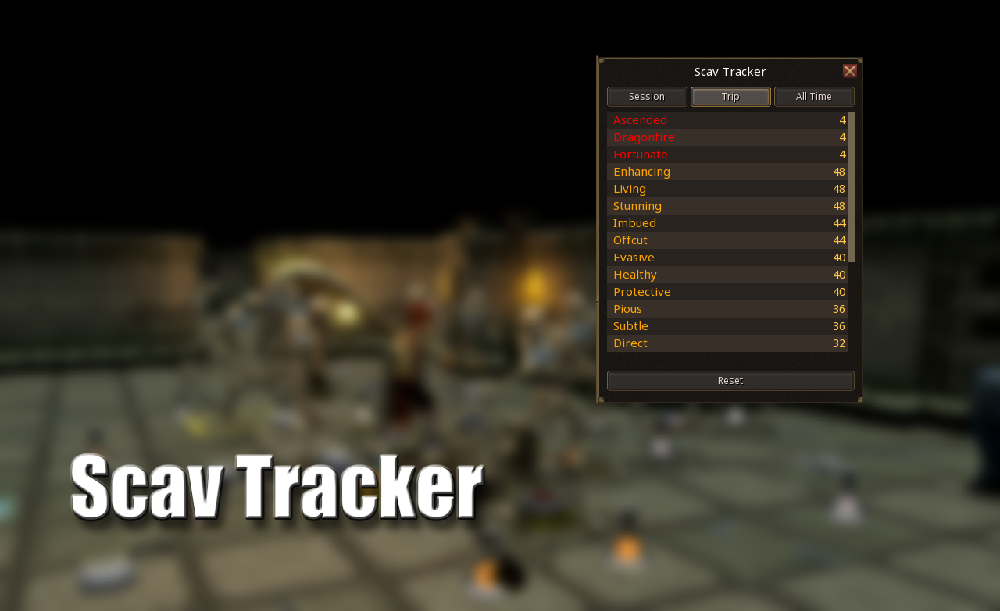

# ScavTracker

Tracks the Invention components you gain from the **Scavenging** perk and
Archaeology **blessings**, read straight from your chat. Counts are split into
three tabs:

- **Session** - resets every time the client launches.
- **Trip** - manually resettable with the Reset button.
- **All Time** - full history since install.

The window is draggable (title bar), resizable (any edge or corner), and can be
hidden. Data is saved per account.

## Sorting

Open the settings (Settings icon on the plugin in the Manage tab) to choose:
Order received, Rarity then count, Rarity then order received, or Count.

## FAQ / Debug

**I closed the window. How do I get it back?**
Open the plugin settings (Settings icon in the Manage tab) and click
"Show window". Tracking keeps running while the window is hidden, so you lose
nothing by closing it.

**What are the default colours?**
Rarity colouring is on by default. Rare components show in red (ff0000) and
uncommon in orange (ffa500). Both are the game's own chat colours. You can
change either in settings, or turn colouring off entirely.

**A new rare component was added to the game. What now?**
Rarity is decided by a list in `data/rarity.lua`. Any component not in that
list is treated as uncommon. To mark a new one as rare, add its lowercased
type name (without the word "components") to the `RARE_SET` table, e.g.
`["newtype"] = true`, then reload the plugin.

**How are rare components tracked?**
Every component gain is counted the same way. "Rare" vs "uncommon" is purely a
label for display and sorting, resolved by matching the component name against
the rare list in `data/rarity.lua`. It does not change what gets counted, only
how it is coloured and ordered.
